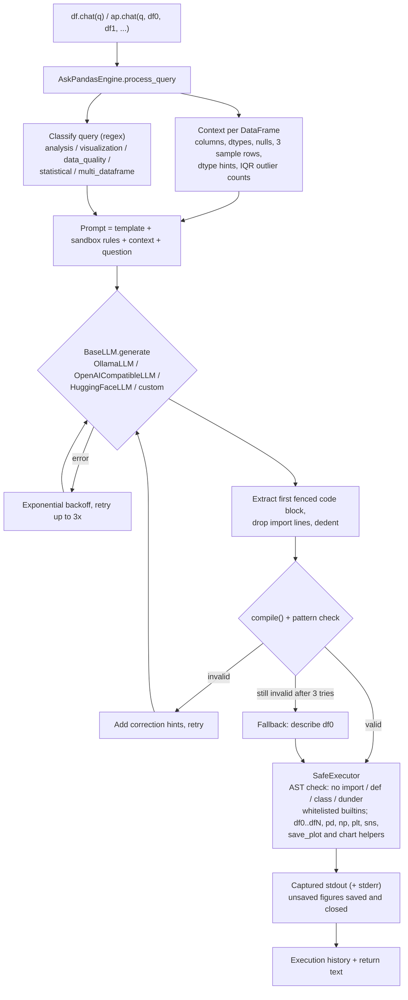

<div align="center">

# AskPandas

**Ask questions about pandas DataFrames and CSV files in plain English: an LLM writes the pandas code, AskPandas runs it in a restricted sandbox and returns the answer.**

[](https://pypi.org/project/askpandas/)
[](https://pypi.org/project/askpandas/)
[](https://pepy.tech/projects/askpandas)
[](https://github.com/irfanalidv/AskPandas/actions/workflows/tests.yml)
[](https://github.com/irfanalidv/AskPandas/actions/workflows/codeql.yml)
[](https://github.com/irfanalidv/AskPandas/blob/main/LICENSE)
[](https://github.com/astral-sh/ruff)
[](https://mypy-lang.org/)
[](https://github.com/irfanalidv/AskPandas/blob/main/CONTRIBUTING.md)

</div>

## Why AskPandas

Writing a one-off `groupby` / `merge` / chart for every ad-hoc question is slow, and pasting a
dataset into a chat window loses the exact numbers. AskPandas keeps your data local: the LLM sees
only a compact summary of each DataFrame (columns, dtypes, null counts, three sample rows) and
replies with pandas code, which AskPandas validates and executes against the real data. You get
results computed by pandas, not numbers guessed by a model, and you can use a free local model
via [Ollama](https://ollama.com) or any OpenAI-compatible API.

## Features

| | |
| --- | --- |
| **Plain-English analytics** | `df.chat("total revenue by region, sorted")` returns what the generated pandas code printed. |
| **Local or hosted LLMs** | `OllamaLLM` (local), `OpenAICompatibleLLM` (OpenAI, Mistral, Groq, Together, vLLM, LM Studio, Ollama `/v1`), `HuggingFaceLLM` (HF Inference Providers), or your own two-method class. |
| **Several DataFrames at once** | `ap.chat(question, orders, customers)` exposes them as `df0`, `df1`, ... for joins and comparisons. |
| **Restricted execution** | Generated code runs without imports, function/class definitions, dunder access or file builtins, with a whitelist of builtins. |
| **Self-correcting loop** | Invalid code is retried with correction hints; LLM errors are retried with exponential backoff. |
| **Charts** | Chart helpers are available to generated code; figures are saved to `askpandas_plots/` (configurable). |
| **Offline helpers** | Data-quality scoring and auto-cleaning, statistical tests (t-test, ANOVA, chi-square, Mann-Whitney, Kruskal-Wallis), dtype/memory optimisation. No LLM needed. |
| **Lightweight and typed** | Depends on pandas, numpy, matplotlib, seaborn, scipy, psutil and requests only (no torch). Ships `py.typed`; mypy-clean. |

## Install

```bash
pip install askpandas
# or
uv pip install askpandas
```

Extras: `askpandas[full]` adds Jupyter, ipywidgets and Plotly; `askpandas[dev]` adds the test and
lint toolchain. Requires Python 3.10+.

## Quickstart

With a hosted model (needs network and `OPENAI_API_KEY`):

```python
import askpandas as ap

ap.set_llm(ap.OpenAICompatibleLLM.openai("gpt-4o-mini"))  # reads OPENAI_API_KEY
# Local and free instead: ap.set_llm(ap.OllamaLLM("llama3.1"))  # needs `ollama serve`

sales = ap.DataFrame("examples/data/demo_sales.csv")
print(sales.chat("What is the total revenue by region? Sort descending."))
```

Output from a run with `gpt-4o-mini` on the bundled sample file (the same numbers as a direct
pandas `groupby`; the wording of the header line depends on the model):

```
Total Revenue by Region:
region
South    50557.76
North    40075.88
East     30787.38
West     26978.72
Name: revenue, dtype: float64
```

Without any model or key, plug in an object with `generate` and `is_available` to see the
pipeline run end to end:

```python
import askpandas as ap


class FixedLLM(ap.BaseLLM):
    """Stands in for a model: always answers with the same pandas code."""

    def generate(self, prompt: str) -> str:
        return "```python\nprint(df0.groupby('team')['tickets'].sum().idxmax())\n```"

    def is_available(self) -> bool:
        return True


ap.set_llm(FixedLLM())
tickets = ap.DataFrame({"team": ["billing", "shipping", "shipping"], "tickets": [12, 30, 9]})
print(tickets.chat("Which team handled the most tickets?"))  # shipping
```

## How it works



Design decisions:

- **The model writes code, pandas computes.** Only a summary of each DataFrame goes into the
  prompt, so large tables do not hit context limits and the numbers come from pandas.
- **One namespace for `exec`.** Globals and locals are the same dict so comprehensions can see
  `df0`, `df1`, ... on every supported Python version.
- **Errors are values inside the sandbox.** A failing snippet returns a message (and is recorded
  as a failure in the engine history) instead of raising, so interactive sessions keep going.
  Problems outside the sandbox raise typed exceptions from `askpandas.exceptions`.
- **Any backend with two methods.** The engine needs only `generate(prompt) -> str` and
  `is_available() -> bool`; the bundled clients use plain `requests` with timeouts.

> **Safety note:** the sandbox blocks the common escape routes (imports, `open`, dunder access,
> `eval`/`exec`, function definitions), but it is a best-effort guard, not a security boundary:
> pandas itself can read and write files. Only run AskPandas with models and data you trust, and
> do not expose it to untrusted users.

## Use cases and recipes

All examples run offline with no API key (the LLM examples use a small scripted backend,
[`offline_llm.py`](https://github.com/irfanalidv/AskPandas/blob/main/examples/offline_llm.py)).

| Script | What it shows |
| --- | --- |
| [`sales_kpis.py`](https://github.com/irfanalidv/AskPandas/blob/main/examples/sales_kpis.py) | Revenue by region, top products and a saved monthly-revenue chart from a CSV. |
| [`customer_segments_multi_df.py`](https://github.com/irfanalidv/AskPandas/blob/main/examples/customer_segments_multi_df.py) | One question that joins orders and customers (`df0`/`df1`) to compare segments and find inactive customers. |
| [`data_quality_audit.py`](https://github.com/irfanalidv/AskPandas/blob/main/examples/data_quality_audit.py) | Quality score, auto-cleaning, ANOVA and Spearman correlations on 1,000 rows, no LLM at all. |
| [`custom_llm_backend.py`](https://github.com/irfanalidv/AskPandas/blob/main/examples/custom_llm_backend.py) | A custom `BaseLLM` that logs prompts, the sandbox rejecting a dunder escape, execution history. `--openai` runs it against OpenAI. |

```bash
git clone https://github.com/irfanalidv/AskPandas && cd AskPandas
pip install -e .
python examples/sales_kpis.py
```

<details>
<summary><b>More things to ask</b></summary>

```python
df.chat("Create a bar chart of revenue by region")        # saved to askpandas_plots/
df.chat("Check for missing values and duplicates")
df.chat("Identify outliers in numeric columns")
df.chat("Show the correlation between price and quantity")
ap.chat("Join customers with their orders and compute revenue per segment", customers, orders)
```

Specific questions work best ("total revenue by month for 2024, excluding returns" rather than
"analyze this data"). Small local models (for example `phi3:mini`) are fast but follow the code
format less reliably than larger ones.

</details>

## Configuration

**Environment variables**

| Variable | Used by |
| --- | --- |
| `OPENAI_API_KEY` | `OpenAICompatibleLLM.openai()` and the `OpenAICompatibleLLM(...)` default |
| `MISTRAL_API_KEY` | `OpenAICompatibleLLM.mistral()` |
| `HF_TOKEN` (or `HF_API_KEY`) | `HuggingFaceLLM` |
| `MPLBACKEND=Agg` | Recommended on headless machines so charts render without a display |

Ollama needs no key; point `OllamaLLM(host=...)` at a remote server if it is not on
`localhost:11434`.

**`ap.set_config(...)` keys**

| Key | Default | Effect |
| --- | --- | --- |
| `output_dir` | `"askpandas_plots"` | Directory where `save_plot` and auto-saved figures go. |
| `plot_style` | `"seaborn"` | Applied to matplotlib when set via `set_config` (`seaborn`, `minimal`, `dark`, `default`). |
| `verbose` | `False` | Logs LLM and config changes on the `askpandas` logger at INFO level. |
| `model_name`, `temperature`, `max_tokens`, `enable_plotting`, `safe_mode`, `max_execution_time`, `enable_history` | see `ap.get_config()` | Stored for forward compatibility; **not enforced yet**. Set temperature, tokens and timeouts on the LLM client instead. |

**Client and engine options**

| Option | Where | Default |
| --- | --- | --- |
| `temperature`, `timeout` | `OllamaLLM(...)` | `0.1`, `120` s |
| `base_url`, `api_key`, `temperature`, `max_tokens`, `timeout`, `system_prompt` | `OpenAICompatibleLLM(...)` | OpenAI URL, env var, `0.1`, `1000`, `60` s, code-only prompt |
| `retry_backoff` | `AskPandasEngine(llm, config={"retry_backoff": 1.0})` | `1.0` s, doubled per retry |

## API overview

| Object | What it does |
| --- | --- |
| `ap.DataFrame(data)` / `AskDataFrame` | Wrap a DataFrame, dict, list of records, or a `.csv`/`.json` path (`str` or `Path`). Adds `.chat()`, `.info()`, `.get_summary_stats()`, `.get_column_info()`, `.clean_columns()`; other attributes pass through to pandas. |
| `ap.set_llm(llm)` / `ap.get_llm()` | Set or get the global LLM used by `.chat()` and `ap.chat()`. |
| `ap.chat(query, *dfs)` | Ask one question across several DataFrames (`df0`, `df1`, ...). |
| `OllamaLLM`, `OpenAICompatibleLLM`, `HuggingFaceLLM`, `BaseLLM` | LLM clients; subclass `BaseLLM` (or duck-type `generate` and `is_available`) to add your own. |
| `AskPandasEngine(llm)` | The engine behind `.chat()`; `get_execution_history()`, `get_engine_stats()`, `get_performance_metrics()`, `export_execution_history("json" \| "csv")`. |
| `ap.analyze_query`, `ap.validate_query`, `ap.get_query_examples` | Regex-based query categorisation, column-reference checks, example prompts. |
| `ap.set_config` / `ap.get_config` | Global settings (see Configuration). |
| `create_bar_chart`, `create_line_chart`, `create_scatter_plot`, `create_histogram`, `create_correlation_heatmap`, `create_box_plot`, `save_plot` | Chart helpers (also available inside generated code). |
| `askpandas.utils.data_quality` | `assess_data_quality`, `clean_dataframe`, `generate_quality_report`, `DataQualityAnalyzer`, `DataCleaner`. |
| `askpandas.utils.statistical` | `StatisticalAnalyzer` (descriptives, correlations with p-values, outliers, normality, hypothesis tests), `quick_stats`, `detect_outliers`. |
| `askpandas.utils.performance` | `optimize_dataframe`, `PerformanceOptimizer`, `PerformanceBenchmark`, `benchmark_function`. |
| `askpandas.exceptions` | `AskPandasError` and subclasses `DataLoadError`, `LLMNotConfiguredError`, `LLMError`, `CodeGenerationError`, `QueryProcessingError` (each also a `ValueError` or `RuntimeError`, as in earlier releases). |

## Statistical methods used

The offline helpers wrap standard methods from SciPy:

- Outlier fences at 1.5 x IQR: Tukey, J. W. (1977). *Exploratory Data Analysis*. Addison-Wesley.
- Normality: Shapiro, S. S. & Wilk, M. B. (1965). An analysis of variance test for normality.
  *Biometrika*, 52(3/4), 591-611; plus a Kolmogorov-Smirnov test against a fitted normal.
- Rank tests: Mann, H. B. & Whitney, D. R. (1947). *Annals of Mathematical Statistics*, 18(1),
  50-60; Kruskal, W. H. & Wallis, W. A. (1952). *Journal of the American Statistical
  Association*, 47(260), 583-621.
- Effect sizes: Cohen's d for t-tests, eta squared for ANOVA, Cramer's V for chi-square.

## When to use it

AskPandas fits exploratory analysis in scripts and notebooks where you trust the model and the
data and want answers computed by pandas. It is deliberately small: the core is a prompt builder,
a code extractor and a sandboxed `exec`. If you need a larger feature set (for example connectors
to many data sources or a hosted UI), look at bigger projects in this space such as
[PandasAI](https://github.com/sinaptik-ai/pandas-ai). For untrusted users or untrusted models, run
generated code in a real isolation layer (container or separate process) rather than relying on
an in-process sandbox.

## Roadmap

- Enforce `max_execution_time` with a subprocess-based executor.
- Return structured results (the last DataFrame or value) alongside printed text.
- Async LLM clients and streaming.

## Contributing, security, citation, license

- Contributing: see [CONTRIBUTING.md](https://github.com/irfanalidv/AskPandas/blob/main/CONTRIBUTING.md)
  (`ruff`, `mypy` and `pytest --cov` must pass; all tests run offline).
- Security: please report vulnerabilities as described in
  [SECURITY.md](https://github.com/irfanalidv/AskPandas/blob/main/SECURITY.md).
- Changelog: [CHANGELOG.md](https://github.com/irfanalidv/AskPandas/blob/main/CHANGELOG.md).
- Citation: if you use AskPandas in research, cite it using
  [CITATION.cff](https://github.com/irfanalidv/AskPandas/blob/main/CITATION.cff) (GitHub's
  "Cite this repository" button reads it).
- License: MIT, see [LICENSE](https://github.com/irfanalidv/AskPandas/blob/main/LICENSE).
